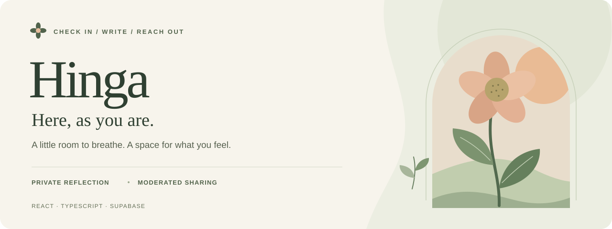
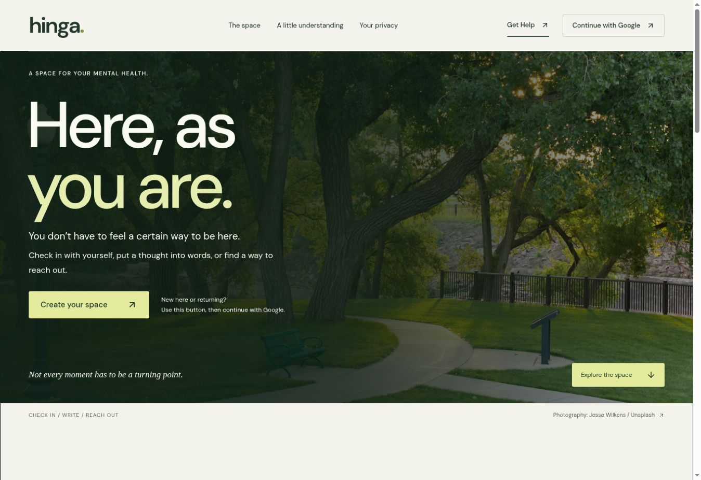
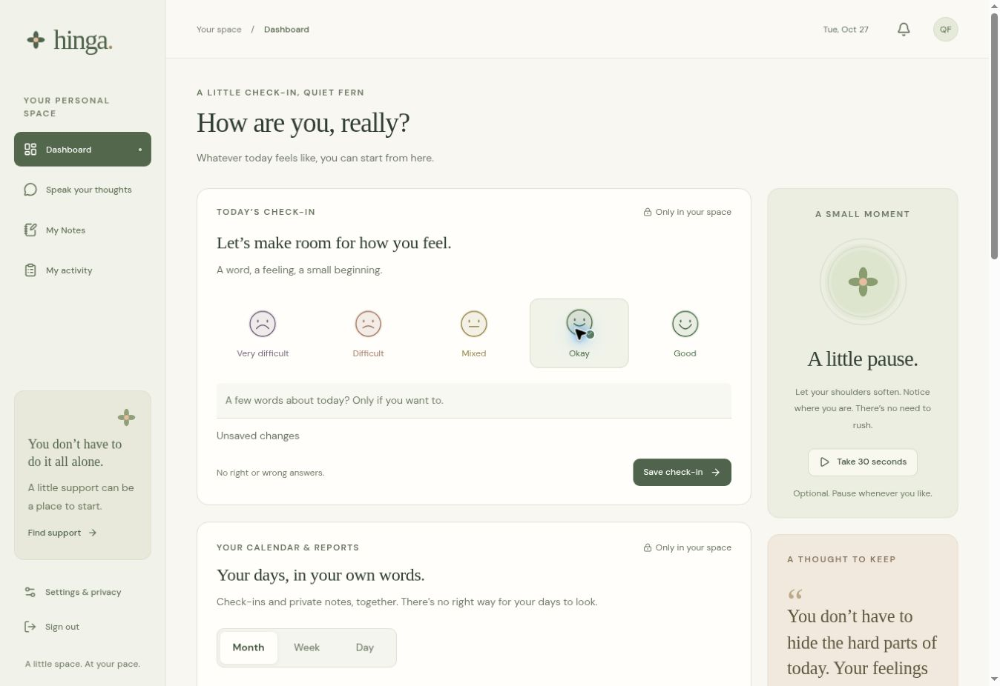
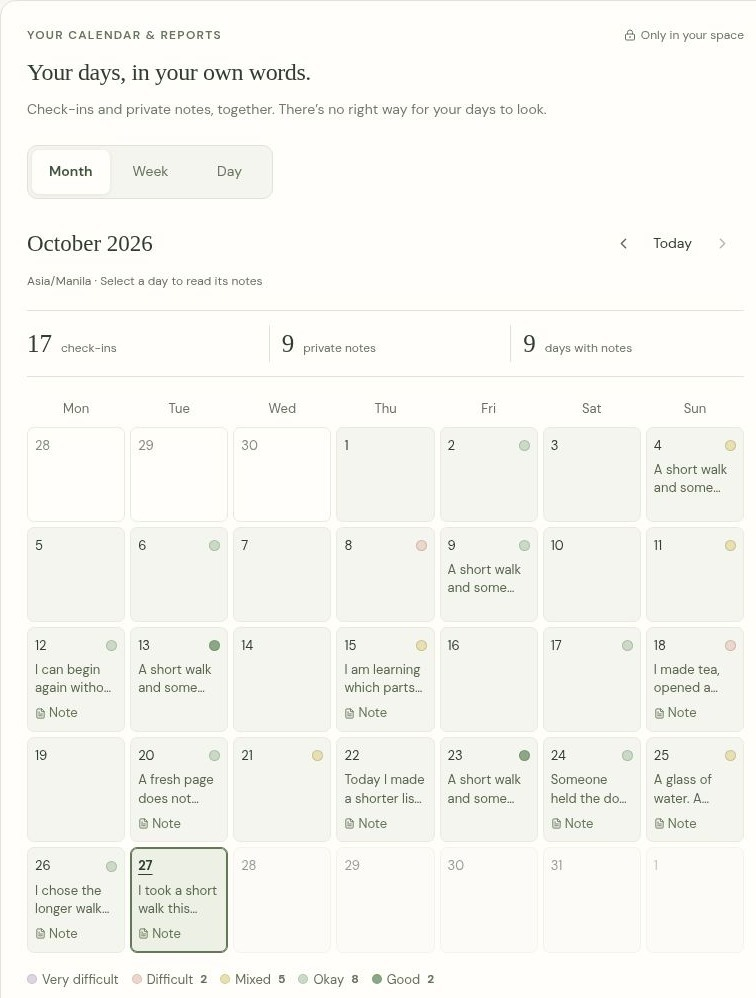
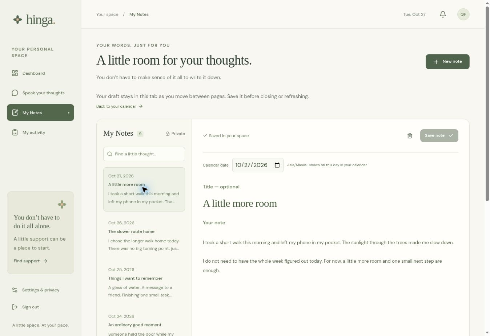
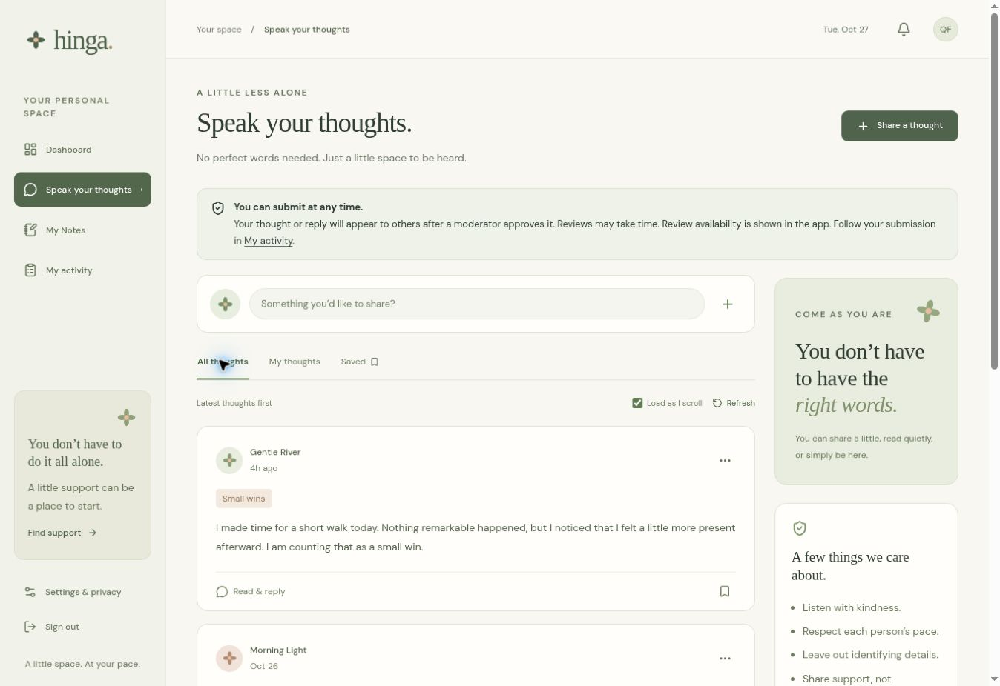
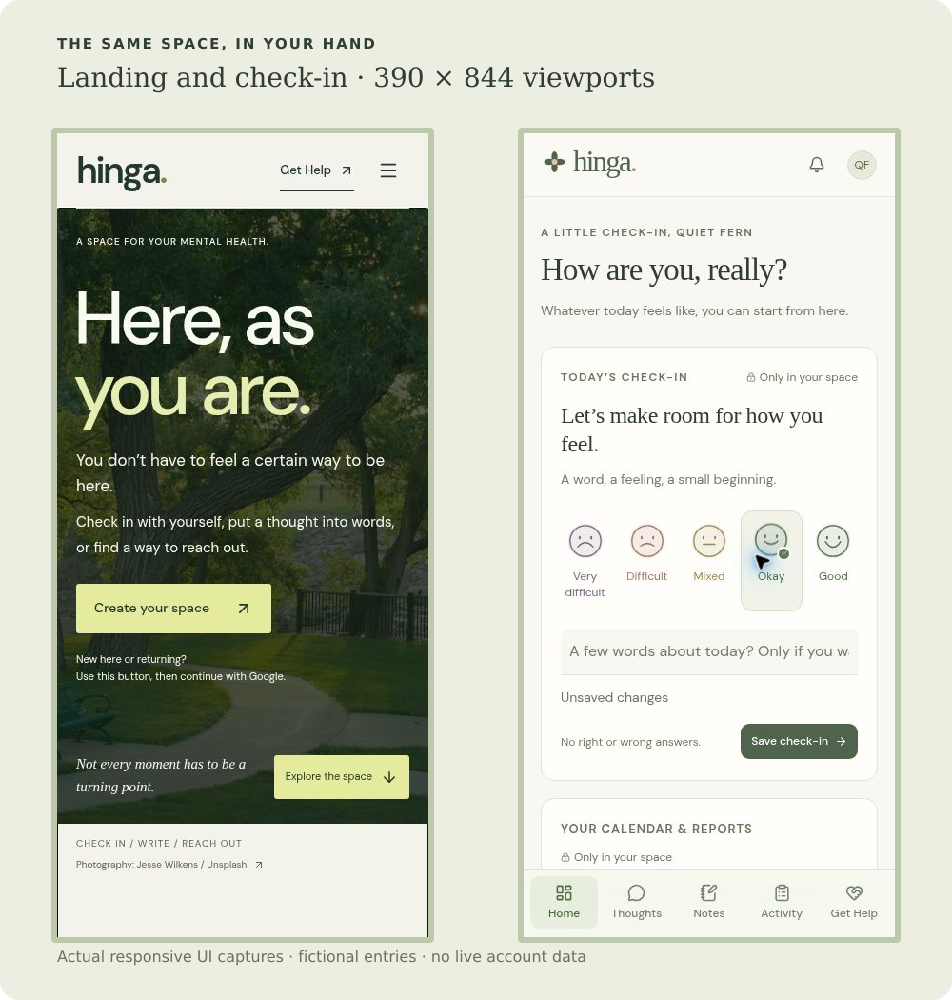
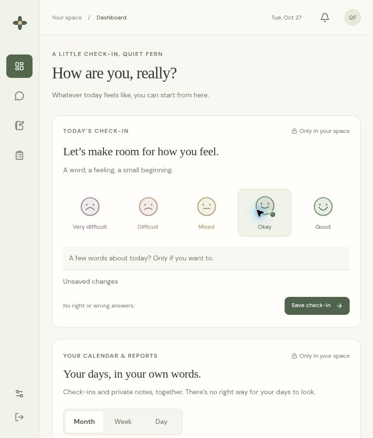
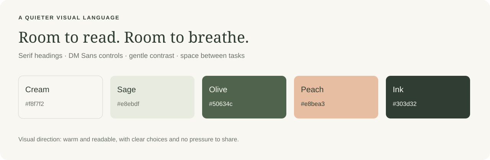
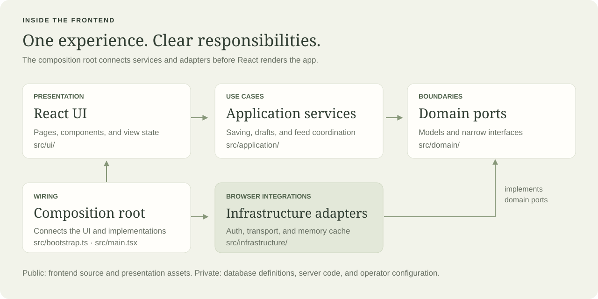

  

# Hinga

**A little room to breathe. A project about making space for people.**

Hinga is a mental health reflection web application that brings together mood check-ins, private journaling, and community discussions reviewed before publication. This repository tells the story of the project and opens up its frontend for anyone who wants to explore the work.

**React · TypeScript · Vite · Tailwind CSS · Supabase · Netlify**

[The idea](#the-idea) · [A walk through Hinga](#a-walk-through-hinga) · [Design language](#the-design-language) · [Tech stack](#the-tech-stack) · [Frontend structure](#inside-the-frontend)

## The idea

I wanted to create a place where someone could check in with themselves without needing to explain everything perfectly. A mood, a few lines in a journal, or a shared thought can each be a different starting point.

The challenge was to bring those experiences together while keeping their purpose clear. Writing for yourself should feel different from publishing something for a community. Looking back through a calendar should help someone notice their days without turning those days into a score to improve.

That became the direction for Hinga: a warm interface, clear choices, private reflection, and a thoughtful path into sharing.

## A walk through Hinga

*These are captures of the actual React interface, made locally with fictional entries and aliases. No live accounts, private journal entries, or database records were used.*

### 01 / A quieter front door

The landing page starts with a photograph, generous typography, and one invitation: **Here, as you are.** Text sits inside the photograph with a dark overlay for contrast. The same primary action guides first-time and returning visitors into Google sign-in.

I moved away from a generic grid of product cards toward a page that introduces the feeling of the space before explaining its tools. Support remains available without creating an account.

### 02 / Start with how today feels

The dashboard makes the mood check-in the main task. Someone can select a feeling, add a few words if they want to, and save deliberately. Selecting a mood and saving it are separate actions, with a visible unsaved state in between.

The calendar follows the check-in. Optional encouragement and a short pause sit alongside it, so the page offers a next step without demanding more input.

### 03 / Let the calendar hold the context

Daily, weekly, and monthly reports connect mood entries with private notes. Each date shows its most recently saved note, while the selected-day panel makes the full entry readable. Earlier notes remain available in My Notes.

  

[See the complete calendar and selected-day note](assets/screens/calendar-full.jpg).

On smaller screens, the calendar keeps date, mood, and note indicators compact. The selected-day panel carries the longer text instead of squeezing it into seven narrow columns.

### 04 / Give private writing its own room

My Notes uses a familiar list-and-editor layout. Notes are searchable and paginated, while the editor keeps the calendar date, optional title, and note body visible. Word and character counts help someone understand the size of an entry.

One practical lesson from building this page was that saving is more than a button: it includes drafts, navigation, failures, and a clear indication of what has actually been saved. Drafts stay in the current tab as the person moves between pages.

### 05 / A familiar feed, with thoughtful sharing

Speak Your Thoughts keeps the familiar rhythm of a scrolling social feed. People can read, submit a thought, reply, save posts, report concerns, and block members. The automatic-loading preference is remembered, with manual controls available too.

Sharing has a different boundary from journaling: posts and replies wait for moderator approval. My activity gives authors a place to follow submissions, and a separate staff interface supports review, reports, and appeals.

### 06 / The same space, in your hand

The layout changes with the screen. Desktop navigation uses a full sidebar, the tablet view keeps a compact rail, and the mobile view places the main destinations along the bottom. Forms and cards flow into a single column on a phone.

See the tablet layout at 768 × 900

  

These responsive captures show layout behavior in browser viewports; they are not a claim of completed testing on every physical device.

## The design language

The visual direction combines cream surfaces, olive actions, sage panels, peach accents, and dark text. Serif headings provide a gentler editorial voice, while DM Sans keeps controls and body text readable. Botanical details connect the landing page and personal space.

The product choices behind the styling matter just as much:

- Use plain language around saving, sharing, and privacy.
- Keep help easy to reach, including before sign-in.
- Label fields rather than depending on placeholders alone.
- Preserve drafts and make errors actionable.
- Treat encouragement and Bible verses as choices, not requirements.
- Avoid competitive streaks or language that scores a person's recovery.

## The tech stack

- **React** builds the pages and reusable components; React Router handles navigation.
- **TypeScript** describes the models, service contracts, and component interfaces.
- **Vite** provides the development server and production bundling.
- **Tailwind CSS and component styles** support the visual system and responsive layouts.
- **Supabase** supplies Google authentication and data services in the connected application. Its database implementation stays private.
- **Netlify** is the intended hosting environment for the application and its private gateway.
- **Lucide and DM Sans** provide the icon and interface type foundations.

## Inside the frontend

The frontend is organized around SOLID principles. React components present the experience and call application services. Services depend on narrow domain contracts; infrastructure supplies the browser integrations. The composition root wires them together.

Explore the actual folders:

- [`src/ui/pages/`](src/ui/pages/) — landing, dashboard, notes, discussions, activity, and review screens.
- [`src/ui/components/`](src/ui/components/) — shared controls, calendar reports, dialogs, and encouragement cards.
- [`src/ui/landing/`](src/ui/landing/) — the photograph-led landing experience and its styles.
- [`src/application/`](src/application/) — use cases, retained drafts, preferences, notifications, and feed coordination.
- [`src/domain/`](src/domain/) — models, date/report logic, and narrow service interfaces.
- [`src/infrastructure/`](src/infrastructure/) — browser-side authentication, request adapters, and memory caching.
- [`src/bootstrap.ts`](src/bootstrap.ts) and [`src/main.tsx`](src/main.tsx) — service composition and the React entry point.
- [`src/styles.css`](src/styles.css) — shared design tokens and application styles.

Three examples of those boundaries in practice:

- **Calendar logic is separate from the calendar UI.** Date ranges and report projections can be understood without a React component or database client.
- **The UI asks services to save.** Validation and persistence coordination do not sit inside every button handler.
- **Browser integrations have their own adapters.** A future mobile client can reuse suitable models and use cases while providing platform-specific presentation and session storage.

## What this public repository contains

This is the frontend source and a visual case study. It includes components, styles, browser-side request interfaces, images, and the build configuration needed to inspect the client. Those interfaces describe what the UI needs; they are not SQL table definitions.

Database schemas and migrations, server functions, gateway implementation, deployment environment values, operator documents, backups, and member data are maintained separately. No populated environment file, API key, account session, or screenshot-capture harness is included here. The connected application requires its separately maintained backend and configuration.
